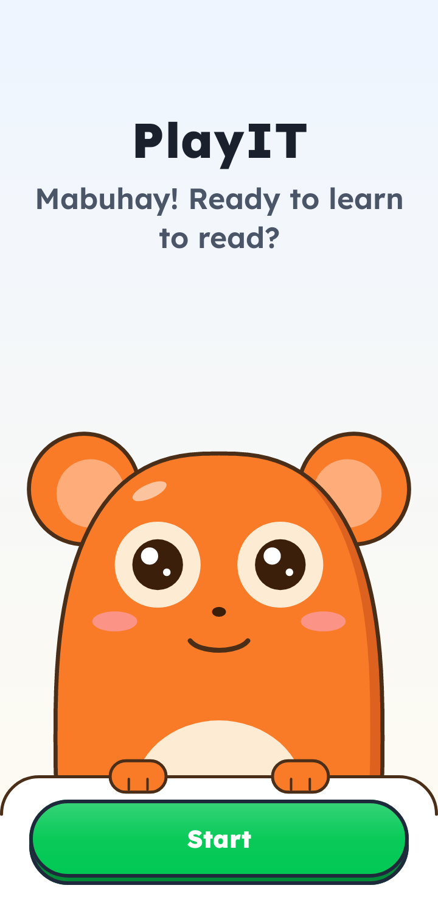
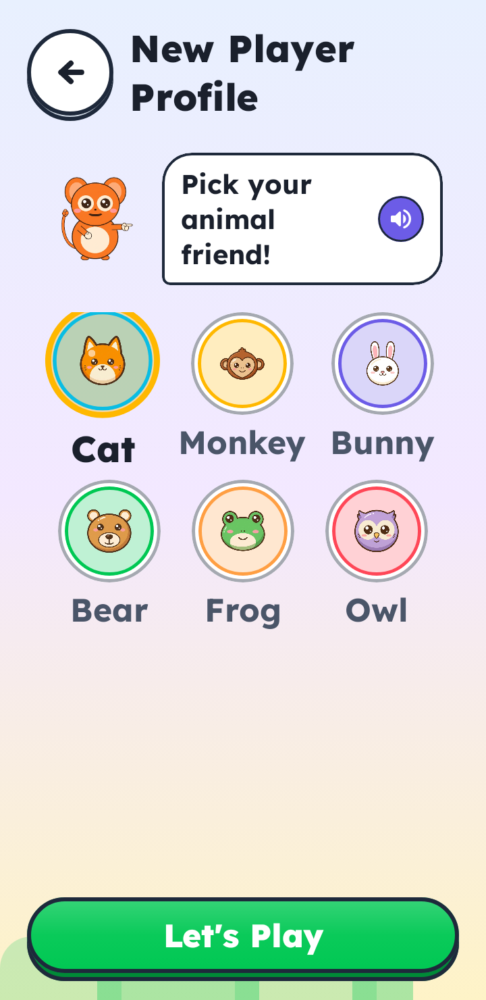
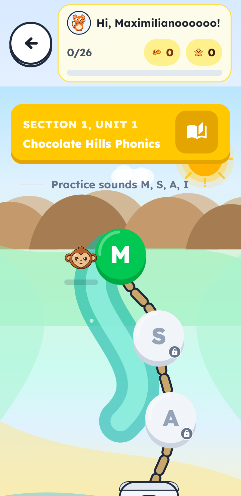
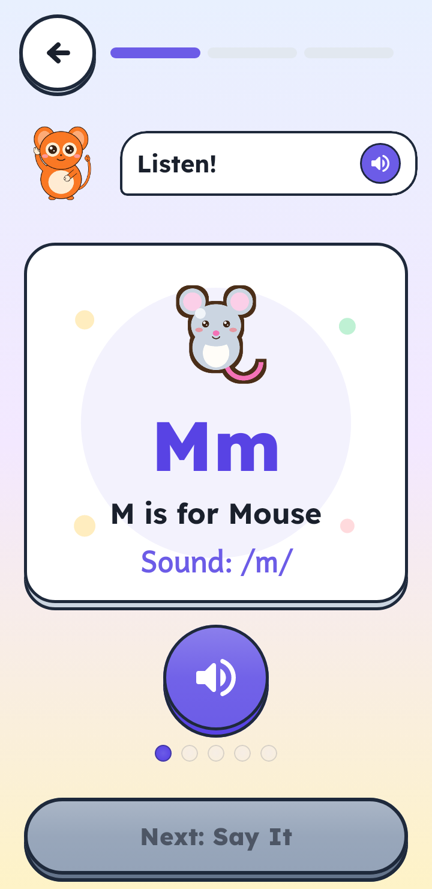
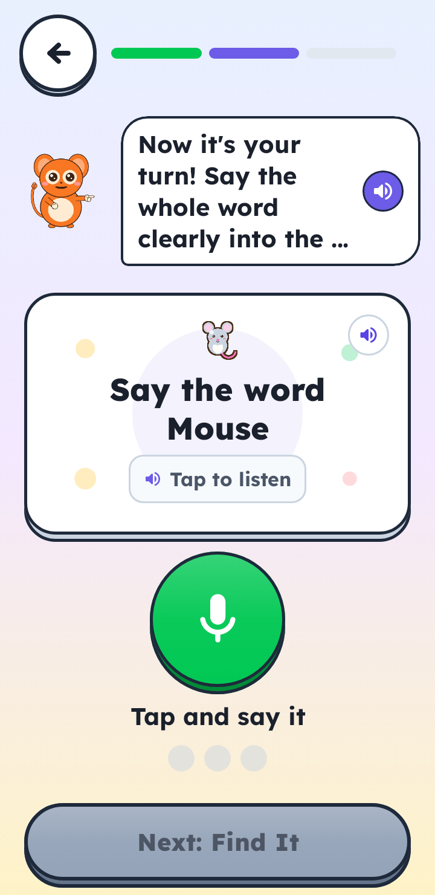
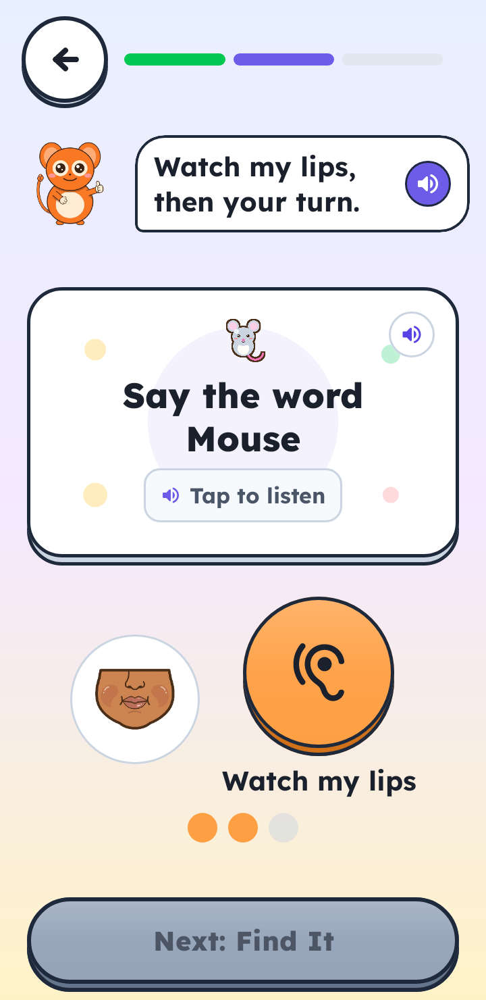
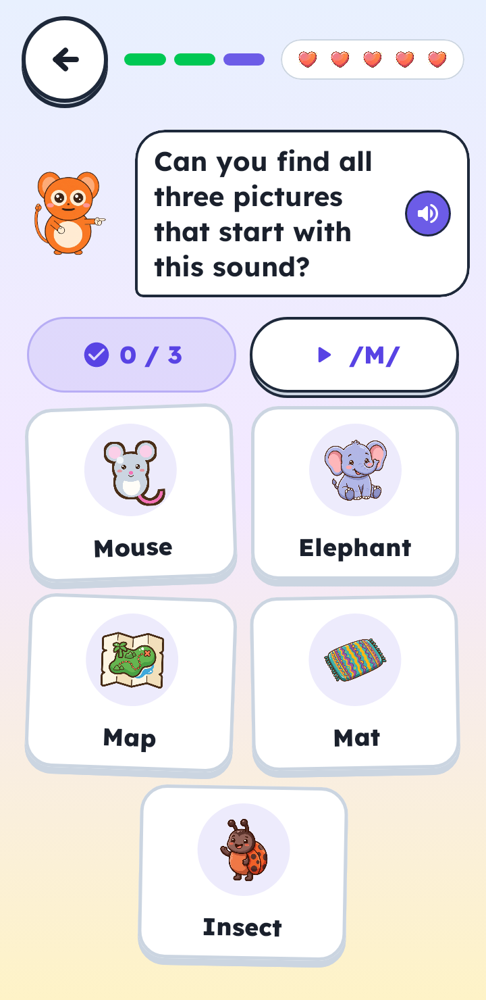
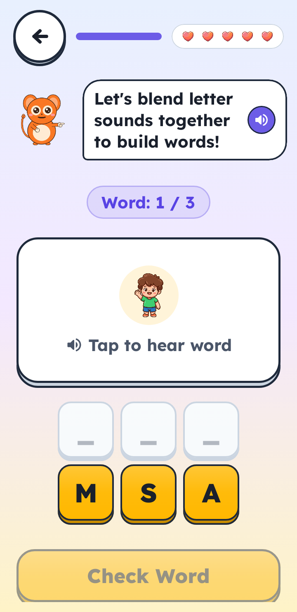

# PlayIT: Offline Phonics for Grade 1 Learners

PlayIT is an Android app that teaches Grade 1 Filipino learners (ages 5 to 7) the sounds of English letters, following the Marungko approach: hear the sound, say it, find it among pictures, then blend letters into words. The speech recognizer runs on the phone, and the app has no internet permission, so nothing a child says or does leaves the device.

IT411 Capstone & Research 2 (Section G7), Group 56, College of Computer Studies, Cebu Institute of Technology - University. Adviser: Mr. Joemarie C. Amparo.

<p>
  
  
  
  
  
  
</p>

## Screens

Captured with Roborazzi from this repository's code on the 360x740 dp profile of the team's test phone (Samsung Galaxy A21s).

<table>
  <tr>
    <td align="center" width="25%"><strong>Splash</strong><br/><br/><em>Start sits below Lily, the tarsier guide</em></td>
    <td align="center" width="25%"><strong>New learner</strong><br/><br/><em>Avatar-only onboarding: no typing</em></td>
    <td align="center" width="25%"><strong>Map</strong><br/><br/><em>Chapter 1 trail; 16-character name in the header</em></td>
    <td align="center" width="25%"><strong>Hear It</strong><br/><br/><em>Lily models the sound, then the key word</em></td>
  </tr>
  <tr>
    <td align="center" width="25%"><strong>Say It</strong><br/><br/><em>Say the key word; judged on the phone</em></td>
    <td align="center" width="25%"><strong>Say It, second miss</strong><br/><br/><em>Mouth-shape cue beside the microphone</em></td>
    <td align="center" width="25%"><strong>Find It</strong><br/><br/><em>Tap the 3 pictures that start with /m/</em></td>
    <td align="center" width="25%"><strong>Blend It</strong><br/><br/><em>Build SAM from tiles dealt out of order</em></td>
  </tr>
</table>

## Curriculum

26 letters in 7 chapters, seeded in `app/src/main/java/com/playit/app/di/DatabaseModule.kt`. N with tilde and NG are not taught (SRS v3.0, section 1.2). Every Blend It word can be sounded out with the letters taught up to its chapter; QUIZ is the one documented exception (*qu* = /kw/).

| Chapter | Letters (key word) | Blend It words |
|:---:|---|---|
| 1 | **m** (mouse), **s** (sun), **a** (apple), **i** (insect) | SAM, SIS, AM |
| 2 | **o** (orange), **b** (ball), **e** (elephant), **u** (umbrella) | BUS, SUB, MOM, SUM, BIB |
| 3 | **t** (tiger), **k** (kite), **l** (lion), **y** (yoyo) | BAT, MAT, KIT, TUB, YAM |
| 4 | **n** (nest), **g** (goat), **p** (pig) | PIG, PAN, BUG, PIN, NAP |
| 5 | **r** (rabbit), **d** (dog), **h** (hat), **w** (watch) | DOG, HAT, HEN, BED, WEB |
| 6 | **c** (cat), **f** (fish), **j** (jug) | CAT, FAN, CAP, CUP, JAM |
| 7 | **q** (queen), **v** (van), **x** (box), **z** (zebra) | VAN, BOX, FOX, ZIP, QUIZ |

## How a Letter Is Taught

1. **Hear It.** Lily, the tarsier guide, models the sound: "Listen!", the sound three times, the key word, then the sound again. The child can replay it.
2. **Say It.** The child says the key word ("mouse"). Vosk judges it on the phone against a grammar that holds the word and its foils (the letter's name, an added vowel). A miss gets a spoken correction for that error; the second miss shows the mouth shape beside the microphone; the third says it together and moves on. Say It never takes a heart.
3. **Find It.** Five pictures; the child taps the three whose names start with the sound. A wrong tap costs one of five hearts; at zero, the child starts again with three.
4. **Letter Complete.** Three stars with no hearts lost, two with one or two, one with three or more.

When every letter of a chapter is done, that chapter's **Blend It** opens: the child builds its words from letter tiles, which are sounded out one by one and never dealt in the answer's order.

## Architecture

Clean Architecture with MVVM, Hilt for dependency injection, and a Room (SQLite) database on the device.

- `domain/`: pure Kotlin (no `android.*` imports): models, managers such as `SpeechValidator`, `HeartManager`, `StarCalculator` and `TutorPolicy`, and 11 repository interfaces.
- `data/`: Room DAOs and the repository implementations, audio playback, the Vosk recognizer and the PDF report.
- `presentation/`: Jetpack Compose screens and their ViewModels.
- `app/src/main/assets/`: the Vosk model (`vosk-model`), the sounds (`audio/`) and the pictures (`images/`).

## Build and Test

Requirements: JDK 17 and the Android SDK (API 34). Point Gradle at the SDK with `ANDROID_HOME` or a `local.properties` file (`sdk.dir=...`).

```bash
./gradlew assembleDebug        # app/build/outputs/apk/debug/app-debug.apk
./gradlew testDebugUnitTest    # 433 tests: 427 passed, 6 skipped by design, 0 failed
./gradlew :app:recordRoborazziDebug --tests "com.playit.app.screenshot.*"   # screen captures
```

The six skipped tests are the font-scale 1.3 checks on the 360x640 profile, which is below the supported floor. Test results are written to `app/build/test-results/testDebugUnitTest/`.

## Trying the App

- No account and no internet connection are needed.
- On "Who is playing?", tap **Add Profile**, pick an animal friend and tap **Let's Play**. The child never types; a parent can add a name in the Parent Zone.
- Tap the current letter on the map to start a lesson.
- **Parent Zone:** the button at the top right of "Who is playing?". Answer the arithmetic question to see each letter's progress, export the PDF report, and rename or delete profiles.

## Documents and Records

- `docs/submission/`: SRS v3.0, SDD v2.0, SPMP v2.0, the Software Test Document (STD v1.0) and the MVP Validation Findings form, in PDF and DOCX.
- `docs/std/evidence/`: the raw JUnit logs, the APK inspection and the audio release check behind the STD.
- `docs/image-release/` and `docs/audio-release/`: the release manifests of the 131 pictures and 76 audio clips that went through review, with each file's SHA-256, its generator and its approval. `PictureAssetsTest` and `AudioResolverTest` check the app's files against them.

## Known Limitations

- Find It distractors are drawn from every letter, not only from letters already mastered (STD DEF-01).
- Stars follow hearts lost only; the SRS's accuracy term is not applied (STD DEF-02, decision pending).
- The letter a and the letters of Chapters 2 to 7 still play sounds from the MVP; the teacher audit of the sounds has not been held.
- Planned, not built: the telemetry log and CSV export, spaced recall, session pacing. Latency and independent completion are measured in the Round 2 field trials.

## Team

Group 56: Riva, Zendrix (Team Lead); Palis, John James; Miel, Kaysean; Durano, Ashlee Skye; Bien, Erik Samuel.

Capstone Adviser: Mr. Joemarie C. Amparo, College of Computer Studies, Cebu Institute of Technology - University.

## AI Assistance and Third-Party Content

In line with the CIT-U CCS academic integrity guidelines, the team discloses the AI tools used and what each produced. The team set the requirements, made the design decisions, approved every released picture and clip, and is responsible for the result.

- **Claude (Anthropic):** architecture and design review, task cards, code review, test design and generation, the audio pipeline scripts, and drafting of the documentation and of this packaging.
- **Google Antigravity ("agy", an AI coding agent):** implemented most of the app code from the team's task cards, and generated pictures with Nano Banana Pro.
- **Pictures:** the 131 released pictures were generated with Argon 4 (80) and Nano Banana Pro (51); each one's generator is recorded in its release manifest. Pictures kept from the MVP predate the manifests.
- **Voices:** synthetic. Kokoro-82M (Apache-2.0) for the carrier lines and key words; Chatterbox-Turbo (MIT) for held sounds such as /m/; ElevenLabs Text to Speech for the Blend It words AM, TUB and YAM and the short /i/. Clips kept from the MVP predate the release gate; the MVP's letter sounds were made with Microsoft Edge TTS.
- **ElevenLabs credit:** the AM, TUB, YAM and /i/ clips were made with [ElevenLabs](https://elevenlabs.io) on the Free plan, which allows non-commercial use with attribution. The app credits elevenlabs.io in the Parent Zone. These clips may not be used commercially.
- **Vosk** (Alpha Cephei, Apache-2.0): offline speech recognition with its small US English model.
