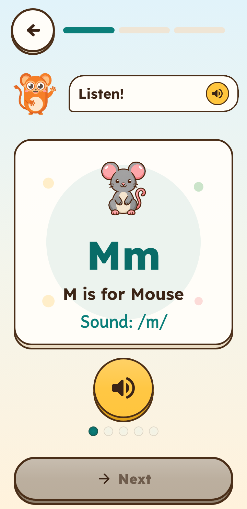
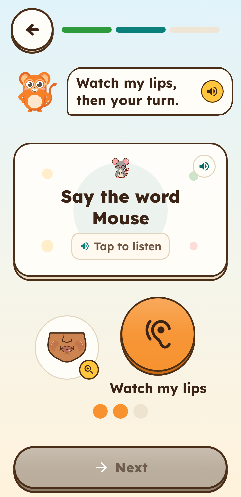
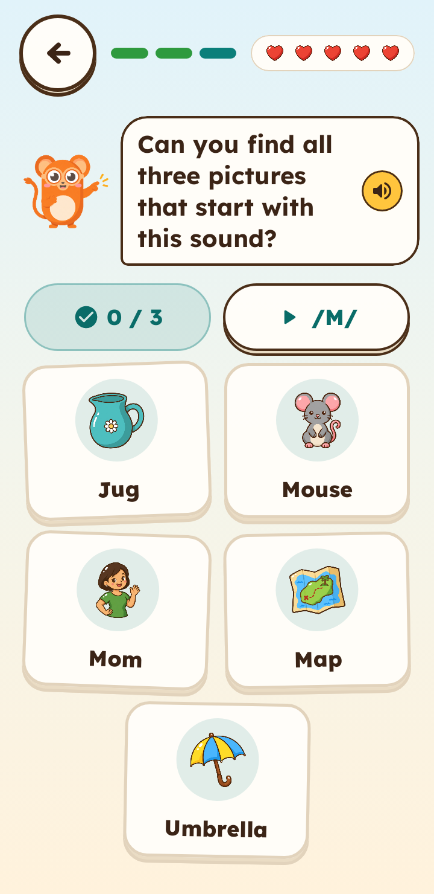
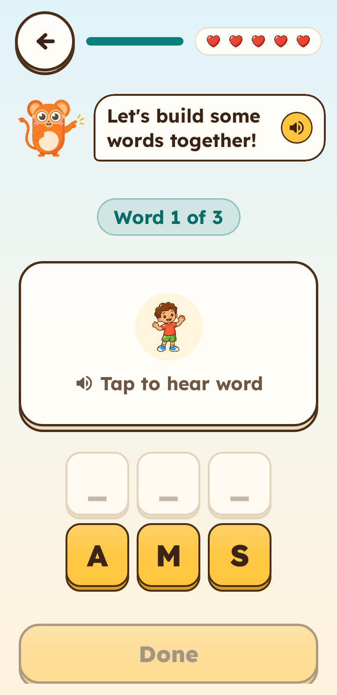
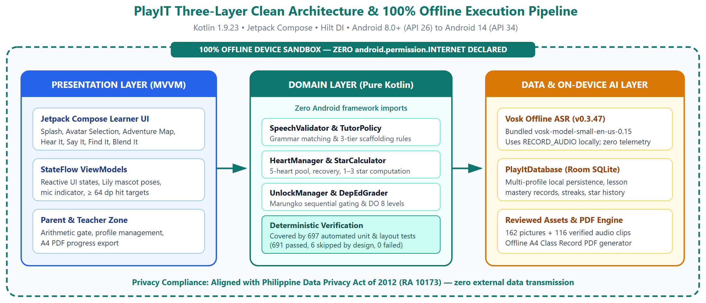
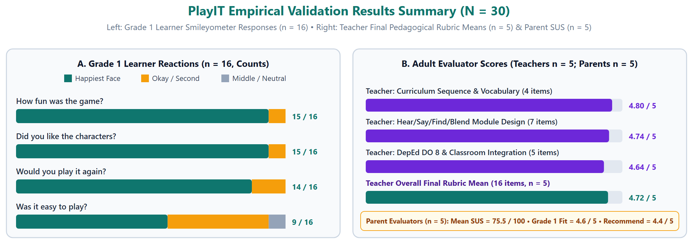

# PlayIT: An Offline-First Gamified Early Literacy Mobile Application Using the DepEd Marungko Approach

**Zendrix Riva, Erik Samuel Bien, Ashlee Skye Durano, Kaysean Miel, John James Palis**  
College of Computer Studies, Cebu Institute of Technology – University, Cebu City, Philippines

**Adviser:** Mr. Joemarie C. Amparo

---

## ABSTRACT

Most Filipino children reach the end of primary school unable to read a simple text, and many Grade 1 learners have no one-on-one help with letter sounds, few materials at home, and no steady internet. We present PlayIT, an Android application that teaches the sounds of the 26 English letters in the order of the Marungko approach used in Philippine public schools. A lesson has three steps (Hear It, Say It, Find It), and each chapter ends with word building (Blend It). A tarsier mascot, Lily, guides the child. Speech is judged on the phone by an offline recognizer, and the application has no internet permission. We evaluated PlayIT in two rounds with 30 participants: 16 Grade 1 learners, 5 parents or supervising adults, and 9 teachers. Fifteen of 16 learners chose the happiest face for enjoyment and 14 of 16 for wanting to play again, but only 9 of 16 for ease. Caregivers gave a mean System Usability Scale score of 75.5 (n = 5). Five teachers rated the final build 4.72 out of 5 on a 16-item teaching rubric. The automated suite of 697 tests passes. The study measured reactions and expert judgement, not learning; we report which planned measures were not collected.

## CCS CONCEPTS

• Applied computing → Computer-assisted instruction; Interactive learning environments • Human-centered computing → Ubiquitous and mobile computing systems and tools; Usability testing • Social and professional topics → Children

## KEYWORDS

Synthetic phonics, Marungko approach, early literacy, offline-first mobile application, on-device speech recognition, child-computer interaction, Android

---

## 1 INTRODUCTION

Reading is the base of all later schooling, and the Philippines has a large reading problem. The World Bank estimated in 2022 that about 91 percent of Filipino children at late primary age could not read and understand a simple text [1]. In the 2018 Programme for International Student Assessment, Filipino 15-year-olds had a mean reading score of 340, the lowest among the 79 participating countries and economies together with the Dominican Republic [2].

The problem starts early. A child who does not learn to connect letters to their sounds in the first grades cannot decode words, and a child who cannot decode cannot read for meaning [3, 4]. In a Philippine public school, three conditions make that first step hard for a Grade 1 learner. One teacher has many readers, so there is little one-on-one time for letter sounds. There are few materials at home, and a worksheet cannot listen to a child or answer back. And many households have no steady internet connection, while most reading applications need one, need a subscription, or follow a letter order that differs from the one used in class.

This paper presents PlayIT, an Android application built to work under those three conditions. It teaches the sounds of the 26 English letters in the order of the Marungko approach, the phono-syllabic method that Philippine public school teachers use to teach beginning reading, which introduces letters by how useful they are for forming words (m, s, a, i first) and not in alphabetical order. The application listens to the child: the child says a key word and the phone itself judges it, using an offline speech recognizer. The build has no internet permission, so it works without a connection and nothing a child says leaves the device. A tarsier mascot named Lily guides each step and never scolds.

The project had four objectives:

1. To build an offline Android application that teaches letter sounds in Marungko order through hearing, saying, finding and blending.
2. To judge a child's spoken answer on the device, with no network.
3. To give parents a plain progress report they can read without training.
4. To find out how learners, parents and teachers receive the application: whether children enjoy it and want to return to it, whether caregivers find it usable, and whether teachers judge its teaching design sound.

This paper contributes (a) the design of an offline phonics application that follows a local letter sequence and checks speech on the device, (b) the results of a two-round evaluation with 30 participants, reported with their limits, and (c) an account of what the evaluation could not measure, as a guide for the next study.

We state one limit at the start. The evaluation measured how people reacted to the application and how experts rated it. It did not test children's reading before and after use, and nothing in this paper is a claim that PlayIT improves reading.

## 2 RELATED WORK

### 2.1 Systematic phonics and letter-sound learning

The National Reading Panel's review of experimental studies concluded that systematic phonics instruction helps children learn to read better than instruction without it, with the largest effects when it begins in kindergarten or Grade 1 [3, 4]. Ehri's phase theory describes how beginning readers move from using partial letter cues to fully connecting letters and sounds, and why letter-sound knowledge and blending are the gateway to decoding [5].

Two findings shaped specific design choices in PlayIT. Ehri, Deffner and Wilce showed that children learn letter sounds more easily when each letter is tied to a picture of an object whose name begins with that sound [6]. PlayIT ties every letter to a key word and picture (m and mouse). Gonzalez-Frey and Ehri showed that teaching beginners to blend with connected sounds, without stopping between phonemes, produced better decoding of unfamiliar words than segmented sounds [7]. This makes the purity of a recorded letter sound important: a clip of /m/ that ends in a vowel ("ma") cannot be blended cleanly. That exact problem appeared in our first evaluation round (Section 5.3).

### 2.2 The Marungko approach

The Marungko approach is a phono-syllabic method for teaching beginning reading that is widely used in Philippine public schools. Letters are introduced by sound, not by name, and in an order chosen so that learners can form syllables and words from the first few letters. Because Grade 1 teachers already use this order, an application that follows it can be used beside classroom lessons instead of competing with them. PlayIT applies the order to the 26 letters of the English alphabet. The letters Ñ and NG of the Filipino alphabet are not taught, because in English orthography *ng* is a digraph and *ñ* does not occur (Section 4.1).

### 2.3 Design for young children

Mayer's principles of multimedia learning hold that people learn better from words and pictures presented together, with extraneous material removed and content given in learner-paced segments [8]. For six-year-olds this argues for one task per screen, spoken instructions, and no decoration that competes with the task. Children of this age also have limited fine motor control; PlayIT uses tapping only, with no dragging, in line with the Web Content Accessibility Guidelines' requirement that dragging have a single-pointer alternative [9].

Asking young children for their opinion is itself a design problem. Read and MacFarlane's Fun Toolkit introduced the Smileyometer, a row of faces a child points to, and also reported that young children tend to choose the happiest face [10]. We used a smileyometer and read its results with that tendency in mind.

### 2.4 Existing applications and the gap

Before building PlayIT the team reviewed seven widely used early-reading applications. Each is strong in some respect, such as polish, game design or reporting. Among those reviewed, none combined all three properties our setting requires: full use without internet, the letter order Philippine teachers use, and a check of the child's own speech on the device. PlayIT was designed to occupy that gap.

## 3 METHODOLOGY

### 3.1 Development approach

PlayIT was developed iteratively across the two capstone semesters. Requirements, design, project plan and tests were documented in a Software Requirements Specification (SRS v3.0), a Software Design Description (SDD v2.0), a Software Project Management Plan (SPMP v2.0) and a Software Test Document (STD v1.0) that follows ISO/IEC/IEEE 29119-3 [11]. A first evaluation round on a minimum viable product was formative: its findings were turned into requirement changes before the build evaluated in the second round.

### 3.2 Evaluation framework

The approved validation plan combined three frameworks, each matched to the group able to judge it:

- **Usability (ISO 9241-11)** [12]: effectiveness, efficiency and satisfaction, for learners and caregivers.
- **Usability, pedagogy and accessibility:** whether the teaching sequence and content are sound and whether the interface suits young children, for teachers.
- **Technology acceptance** [13]: perceived usefulness and ease of use, for caregivers.

Software quality was checked against the product quality characteristics of ISO/IEC 25010 [14] through automated tests.

### 3.3 Participants

Thirty people took part across two rounds (Table 1). They were a convenience sample reached at classroom, home and community sites. Participants are identified by code only, in line with the Data Privacy Act of 2012 [15].

**Table 1. Participants (N = 30).**

| Group | n | Role | Instrument |
|---|:---:|---|---|
| Grade 1 learners (ages 5 to 7) | 16 | Users; observed while playing | Smileyometer, 4 questions |
| Parents or supervising adults | 5 | Evaluators | System Usability Scale; accessibility checklist; 2 fit items |
| Teachers and reading specialists | 9 | Evaluators | Checklist (Round 1); rubric (Round 2) |
| Technical evaluators | 0 | Planned, not recruited | — |

The learners are the application's users. Parents and teachers are evaluators: a parent hands over the phone and a teacher decides whether the application fits the lesson, so their acceptance is the bridge to the child. The three teacher forms together hold 13 responses; some teachers answered more than one form, and counted once each they number up to 9. The plan called for three technical evaluators; none were recruited, and the measures assigned to them were not taken.

### 3.4 Instruments

**Learners.** After a play session each child was shown a row of faces and asked four questions: how fun the game was, whether it was easy to play, whether they liked the characters, and whether they would play again [10]. A facilitator recorded the answer. The plan also included an observation rubric for each lesson step, with task times; these observations were not recorded in the response workbook and are not reported.

**Caregivers.** The five caregivers completed the ten-item System Usability Scale (SUS), scored by Brooke's method [16], a seven-item yes/no accessibility checklist, and two five-point items: whether the application fits a Grade 1 learner and whether they would recommend it. The plan's technology-acceptance items for Round 2 were not collected.

**Teachers.** In Round 1, four teachers answered a 12-item yes/no checklist on curriculum alignment, sequence, feedback and sound accuracy, and wrote comments. In Round 2, teachers rated the refactored build on a five-point rubric. A draft form of 18 items was answered by four teachers and then revised, after an audit, into a final rubric of 16 items in three parts (curriculum, modules, and DepEd alignment and classroom use), answered by five teachers.

### 3.5 Procedure

Round 1 ran from 16 to 23 September 2026 on the minimum viable product, installed on Android phones and tablets. The protocol called for a session of about 15 minutes in which the child created a profile, completed one letter and one word-building challenge, and then answered the smileyometer. Caregivers answered their form after watching a child use the application. Teachers reviewed the application and completed the checklist. The protocol asked for a quiet room, checked with the application's built-in noise indicator.

Round 2 took place in November 2026 on the refactored build and collected the teacher rubrics.

### 3.6 Analysis

Results are reported as counts and means with group sizes. For proportions we give 95% Wilson score intervals [17], and for the SUS mean a 95% confidence interval from the t distribution. The groups are small, so the intervals are wide and we draw no inferential conclusions beyond them.

## 4 SYSTEM DESIGN AND IMPLEMENTATION

### 4.1 Curriculum

PlayIT teaches 26 letters in seven chapters (Table 2). Each chapter ends with word building using only letters taught up to that point, so every word can be sounded out; QUIZ is the one documented exception (*qu* = /kw/).

**Table 2. Letters and Blend It words by chapter.**

| Chapter | Letters (key word) | Blend It words |
|:---:|---|---|
| 1 | m (mouse), s (sun), a (apple), i (insect) | SAM, SIS, AM |
| 2 | o (orange), b (ball), e (elephant), u (umbrella) | BUS, SUB, MOM, SUM, BIB |
| 3 | t (tiger), k (kite), l (lion), y (yoyo) | BAT, MAT, KIT, TUB, YAM |
| 4 | n (nest), g (goat), p (pig) | PIG, PAN, BUG, PIN, NAP |
| 5 | r (rabbit), d (dog), h (hat), w (watch) | DOG, HAT, HEN, BED, WEB |
| 6 | c (cat), f (fish), j (jug) | CAT, FAN, CAP, CUP, JAM |
| 7 | q (queen), v (van), x (box), z (zebra) | VAN, BOX, FOX, ZIP, QUIZ |

### 4.2 How a letter is taught

**Hear It.** Lily models the sound: "Listen!", the sound three times, the key word, then the sound again. The child can replay it.

**Say It.** The child says the key word. The recognizer judges it on the phone against a small grammar that holds the word and its likely mistakes, such as the letter's name or an added vowel. A miss gets a spoken correction for that specific mistake. The second miss shows a drawing of the mouth shape beside the microphone. On the third, Lily says the word together with the child and the lesson moves on. Say It never takes a heart: a child is not penalised for how the microphone hears them.

**Find It.** Five pictures appear and the child taps the three whose names start with the sound. A wrong tap costs one of five hearts; at zero the child starts the step again with three.

**Letter complete.** The child earns three stars with no hearts lost, two with one or two lost, and one otherwise.

**Blend It.** When every letter of a chapter is done, the chapter's Blend It opens. The child builds each word from letter tiles, which are sounded out one by one and are never dealt in the order of the answer.

Figure 1 shows the four screens.

   

**Figure 1.** Hear It; Say It on the second miss, with the mouth-shape cue; Find It; Blend It.

### 4.3 Design for a six-year-old

The child never types and never needs to read an instruction. A new learner picks an animal avatar. Every child-facing control is at least 64 dp, the interaction is tap only, and each screen holds one task. Feedback is immediate and never punitive, and Lily's lines are recorded encouragement. All interface graphics consist of custom-drawn, reviewed illustrations.

### 4.4 Parent Zone

Behind an arithmetic question that a young child is unlikely to answer, a parent sees each letter's progress in plain words, can export a PDF report, and can rename or delete profiles. Several learners can share one phone, each with a profile.

### 4.5 Architecture

PlayIT is a native Android application written in Kotlin with Jetpack Compose. It follows Clean Architecture with the Model-View-ViewModel pattern and Hilt for dependency injection:

- a **domain** layer of pure Kotlin rules with no Android imports, for example the speech judge, the heart and star rules, the tutoring policy and the unlock rule;
- a **data** layer with a Room (SQLite) database, audio playback, the speech recognizer and the PDF report;
- a **presentation** layer of Compose screens and their ViewModels.

**Figure 2.** PlayIT offline Clean Architecture layers and on-device Vosk speech recognition pipeline.

Speech recognition uses Vosk [18], which runs entirely on the device from a model shipped inside the application. The minimum supported version is Android 8.0 (API 26). The manifest declares microphone access and no internet permission, which makes the offline and privacy properties verifiable from the build itself and not only from the team's description.

### 4.6 Content pipeline

The application ships 162 pictures and 116 audio clips. Each passed a review and is recorded in a release manifest with its SHA-256 hash, how it was made and who approved it. Two automated tests compare the files in the application with those manifests, so an unreviewed sound or picture cannot enter a build unnoticed.

## 5 RESULTS

### 5.1 Software verification

The automated suite has 697 tests: 691 pass, 6 are skipped by design and none fail. The six skipped tests are font-scale checks on a 360 x 640 dp screen, which is below the supported floor. A layout matrix runs 23 checks on four screen profiles (86 pass, 6 skipped). The suite was re-run on a second computer on 14 November 2026 with the same result.

The Software Test Document records the midterm build. It specified test cases against the requirements, and on that build seven incidents found in testing were fixed and closed. Two defects remained open: Find It draws its wrong pictures from every letter and not only from letters already learned, and the star rule uses hearts lost only, without the accuracy term in the requirements. Neither stops a child from finishing a lesson.

Three planned software measures were not taken: response latency on the device, persistence across restarts on the device, and the agreement of the speech judge with a teacher's judgement on children's voices.

### 5.2 Learners

Table 3 gives the children's answers. No child chose either of the two lowest faces on any question.

**Table 3. Learners' smileyometer answers (n = 16).**

| Question | Happiest face | Second face | Middle face | Happiest face, 95% Wilson interval |
|---|:---:|:---:|:---:|:---:|
| How fun was the game? | 15 | 1 | 0 | 72% to 99% |
| Did you like the characters? | 15 | 1 | 0 | 72% to 99% |
| Would you play it again? | 14 | 2 | 0 | 64% to 97% |
| Was it easy to play? | 9 | 6 | 1 | 33% to 77% |

Fifteen of 16 children chose the happiest face for enjoyment and for the characters, and 14 of 16 for wanting to play again. Ease was clearly lower: 7 of 16 did not choose the happiest face. Facilitator notes from the same sessions record children hesitating at the microphone in Say It, where the first build gave no sign that it was listening.

### 5.3 Teachers, Round 1

All four teachers answered yes to 11 of the 12 checklist items, including alignment with Grade 1 competencies, the logic of the letter sequence, the difficulty level, immediate feedback, and pictures and language familiar to Filipino children. The twelfth item, whether letter sounds are pronounced correctly, was flagged by two of the four. One teacher wrote:

> "The app is very useful and engaging for Grade 1 learners. […] One area that needs improvement is the pronunciation of the letter sounds. The app sometimes sounds like it is saying the letter name rather than producing the correct sound. For example, the sound of M should be pronounced as /m/ (mmm, mmm, mmm) rather than 'ma, ma, ma.'" (T-1, DepEd Grade 1 reading teacher)

A second teacher raised the same concern (T-2). This was the most important finding of the round, because a letter sound with an added vowel cannot be blended (Section 2.1).

### 5.4 Caregivers

The mean SUS score was 75.5 out of 100 (n = 5; SD 14.62; 95% CI 57.3 to 93.7). Individual scores were 77.5, 50.0, 80.0, 85.0 and 85.0. The mean is above the commonly cited average of 68 [19, 20] and at the project's target of 75, but with five respondents neither difference is statistically significant. One respondent agreed with all ten items, including the five negatively worded ones, a pattern consistent with careless responding; no exclusion rule had been set beforehand, so that response is kept in the mean.

On the five-point items, the mean for fit to a Grade 1 learner was 4.6 and for recommending the application 4.4; all five caregivers answered 4 or 5 on both. On the accessibility checklist, all five answered yes for large text, audio narration, simple touch, colour contrast and Grade 1 language; four of five for motor accommodation; and three of five for accommodation of hearing difficulty.

### 5.5 Changes made after Round 1

The findings were turned into requirement and design changes, verified by automated tests where a test can check them:

- **Pure letter sounds.** The requirement for Hear It was rewritten to demand pure phonemes with no added vowel, and letter sounds are re-recorded and released through a review gate. This work and the teacher audit of the sounds are not finished for every letter (Section 6.3).
- **A visible listening state.** The Say It microphone now shows when it is listening.
- **Mouth-shape cues.** A drawing of the mouth for each sound appears on the second miss, which also answers the hearing-accommodation result.
- **Touch targets.** An audit found controls smaller than the 64 dp floor; all child-facing controls now meet it.

### 5.6 Teachers, Round 2

Four teachers answered the 18-item draft rubric; its overall mean was 3.81, or 4.74 with straight-1 responses excluded. The form was then audited and revised. Five teachers answered the final 16-item rubric on the refactored build. The overall mean was 4.72 out of 5, and all five teachers gave 4 or higher on 15 of the 16 items (Table 4).

**Table 4. Final teacher rubric, mean per item (n = 5; scale 1 to 5).**

| Item | Mean |
|---|:---:|
| *Curriculum* | |
| Marungko letter sequence (m, s, a, i …) | 4.8 |
| Excluding NG and Ñ for the 26 English letters | 4.8 |
| Chapter pacing (3 to 4 letters per chapter) | 4.8 |
| Culturally familiar Filipino vocabulary | 4.8 |
| *Modules* | |
| Hear It: pure phoneme pronunciation | 4.6 |
| Articulation modelling (mouth shapes) | 4.8 |
| Say It: key-word practice | 4.8 |
| Fairness of the speech recognition | 4.8 |
| Find It: progressive fading of word labels | 4.6 |
| Sound check before Blend It | 4.8 |
| Blend It: three-letter word building | 4.8 |
| *DepEd alignment and classroom use* | |
| DepEd Order 8 progress levels | 4.8 |
| DepEd transmuted grades | 4.2 |
| Printable class record for teachers | 4.6 |
| Independent use by the learner | 4.8 |
| Balance of hearts and stars | 4.8 |
| **Overall** | **4.72** |

**Figure 3.** Summary of Grade 1 learner Smileyometer counts (n = 16), final teacher pedagogical rubric domain means (n = 5), and parent usability ratings (n = 5).

The item that Round 1 teachers had flagged, the purity of the letter sounds, was rated 4.6. The lowest item, 4.2, concerns the conversion of game results into DepEd transmuted grades [21].

### 5.7 Objectives against targets

Table 5 sets the results against the targets of the approved plan. One target was met at the margin, one was met on 15 of 16 items, and three could not be judged because the measure was not taken.

**Table 5. Planned targets and outcomes.**

| Objective | Target | Outcome |
|---|---|---|
| Learners complete the lesson steps | At least 85% completion without help; at least 75% pass Say It on the first try | **Not measured.** Step observations were not recorded. |
| Usability for caregivers | Mean SUS of at least 75 | **Met at the margin:** 75.5 (n = 5; 95% CI 57.3 to 93.7) |
| Caregiver acceptance | Perceived usefulness at least 4.2; intention to use at least 4.0 | **Not measured.** Items not collected. Related items: Grade 1 fit 4.6, recommend 4.4. |
| Teaching design judged sound | Every teacher rates every item at least 4.0 | **Met on 15 of 16 items:** every teacher gave 4 or higher on 15 items; all item means are 4.2 or higher; overall 4.72 (n = 5) |
| Offline operation and reporting | No data loss; report within 3 seconds; three technical evaluators | **Not measured** by evaluators. The build has no internet permission and ran offline at every site. |

## 6 DISCUSSION

### 6.1 What the evidence supports

Three results stand on the evidence. First, children liked the application. Nearly all chose the happiest face for enjoyment and for the characters, and most wanted to play again. Second, teachers judged the teaching design sound, and did so twice, with different instruments and partly different teachers: a checklist on the first build and a more demanding rubric on the refactored one. Third, the software does what its requirements say wherever a test can check it, and its offline and privacy properties follow from the build itself.

### 6.2 What the first round changed

The most useful outcome of Round 1 was a criticism. Teachers endorsed almost everything and then identified the one flaw that mattered most for teaching: letter sounds that carried a vowel. The research on connected phonation explains why this matters [7], and the team would not have found it without teachers listening. The lowest learner result pointed the same way from a different side: children were least sure about ease, and the notes located the difficulty at the microphone. Both findings became requirements, and the Round 2 rubric then rated the phoneme audio at 4.6 and the fairness of speech recognition at 4.8. This is an expert rating of a design, not a measurement of recognition accuracy, which remains to be done.

### 6.3 Limitations

The results should be read with these limits in mind.

- **No measure of learning.** No reading test was given before or after use. The study cannot say whether PlayIT helps children read.
- **Small convenience sample.** Sixteen learners, five caregivers and nine teachers, reached where the team had access. The intervals in Section 5 are wide.
- **Children's ratings.** Young children tend to choose the happiest face [10]. One facilitator, who was also a teacher-evaluator, recorded 13 of the 16 ratings. The learner results are weak evidence of engagement, not proof of it.
- **Measures not taken.** Task completion and time per step, the Round 2 caregiver acceptance items, latency, and the speech judge's agreement with teachers were planned and not collected. No technical evaluators took part.
- **One short session.** Each learner used the application once. Nothing is known about use over weeks.
- **Known gaps in the product.** Two defects are open (Section 5.1). The project's README records that some letters still play sounds from the first build, pending re-recording and the teacher audit. Telemetry with export, spaced recall of earlier letters, and session pacing are planned and not built.

## 7 CONCLUSION AND FUTURE WORK

PlayIT shows that a phonics application for Grade 1 can run fully offline, follow the letter order Philippine teachers already use, and check a child's speech on the phone itself. In an evaluation with 30 participants, learners enjoyed it and wanted to play again, caregivers rated its usability at the project's target, and teachers rated its teaching design highly on two occasions. The first round's sharpest criticism, impure letter sounds, was acted on and rated well in the second.

The evaluation did not measure learning, and several planned measures were not taken. The next steps follow directly:

1. Finish the teacher audit of the letter sounds for all chapters.
2. Measure the speech judge against teachers' judgement on recordings of children's voices, in classroom noise, and measure latency on the device.
3. Build the planned telemetry, so that task completion and time per step are recorded by the application and not by an observer.
4. Close the two open defects.
5. Run a study over a school term, with a reading measure before and after and a comparison group, to find out whether children who use PlayIT learn letter sounds faster than those who do not.

Only the last of these can answer the question the application exists for.

## ACKNOWLEDGMENTS

We thank the Grade 1 learners, parents and teachers who gave their time to try PlayIT and to tell us what was wrong with it, and our adviser, Mr. Joemarie C. Amparo, and course instructor, Mr. Ralph P. Laviste, for their guidance.

## REFERENCES

[1] World Bank. 2022. *Philippines Learning Poverty Brief.* World Bank, Washington, DC.

[2] OECD. 2019. *PISA 2018 Results (Volume I): What Students Know and Can Do.* OECD Publishing, Paris. https://doi.org/10.1787/5f07c754-en

[3] National Reading Panel. 2000. *Teaching Children to Read: An Evidence-Based Assessment of the Scientific Research Literature on Reading and Its Implications for Reading Instruction.* NIH Publication No. 00-4769. National Institute of Child Health and Human Development, Washington, DC.

[4] Linnea C. Ehri, Simone R. Nunes, Steven A. Stahl, and Dale M. Willows. 2001. Systematic phonics instruction helps students learn to read: Evidence from the National Reading Panel's meta-analysis. *Review of Educational Research* 71, 3 (2001), 393–447. https://doi.org/10.3102/00346543071003393

[5] Linnea C. Ehri. 2005. Learning to read words: Theory, findings, and issues. *Scientific Studies of Reading* 9, 2 (2005), 167–188.

[6] Linnea C. Ehri, Nancy D. Deffner, and Lee S. Wilce. 1984. Pictorial mnemonics for phonics. *Journal of Educational Psychology* 76, 5 (1984), 880–893.

[7] Selenid M. Gonzalez-Frey and Linnea C. Ehri. 2021. Connected phonation is more effective than segmented phonation for teaching beginning readers to decode unfamiliar words. *Scientific Studies of Reading* 25, 3 (2021), 272–285.

[8] Richard E. Mayer. 2009. *Multimedia Learning* (2nd ed.). Cambridge University Press, New York, NY.

[9] World Wide Web Consortium. 2023. *Web Content Accessibility Guidelines (WCAG) 2.2.* W3C Recommendation. https://www.w3.org/TR/WCAG22/

[10] Janet C. Read and Stuart MacFarlane. 2006. Using the Fun Toolkit and other survey methods to gather opinions in child computer interaction. In *Proceedings of the 2006 Conference on Interaction Design and Children (IDC '06).* ACM, New York, NY, 81–88. https://doi.org/10.1145/1139073.1139096

[11] ISO/IEC/IEEE. 2013. *ISO/IEC/IEEE 29119-3:2013 Software and systems engineering — Software testing — Part 3: Test documentation.* International Organization for Standardization, Geneva.

[12] ISO. 2018. *ISO 9241-11:2018 Ergonomics of human-system interaction — Part 11: Usability: Definitions and concepts.* International Organization for Standardization, Geneva.

[13] Fred D. Davis. 1989. Perceived usefulness, perceived ease of use, and user acceptance of information technology. *MIS Quarterly* 13, 3 (1989), 319–340.

[14] ISO/IEC. 2011. *ISO/IEC 25010:2011 Systems and software engineering — Systems and software Quality Requirements and Evaluation (SQuaRE) — System and software quality models.* International Organization for Standardization, Geneva.

[15] Republic of the Philippines. 2012. *Republic Act No. 10173: Data Privacy Act of 2012.*

[16] John Brooke. 1996. SUS: A "quick and dirty" usability scale. In *Usability Evaluation in Industry,* Patrick W. Jordan, Bruce Thomas, Bernard A. Weerdmeester, and Ian L. McClelland (Eds.). Taylor & Francis, London, 189–194.

[17] Edwin B. Wilson. 1927. Probable inference, the law of succession, and statistical inference. *Journal of the American Statistical Association* 22, 158 (1927), 209–212.

[18] Alpha Cephei. Vosk offline speech recognition toolkit. https://alphacephei.com/vosk/

[19] Aaron Bangor, Philip Kortum, and James Miller. 2009. Determining what individual SUS scores mean: Adding an adjective rating scale. *Journal of Usability Studies* 4, 3 (2009), 114–123.

[20] Jeff Sauro and James R. Lewis. 2016. *Quantifying the User Experience: Practical Statistics for User Research* (2nd ed.). Morgan Kaufmann, Cambridge, MA.

[21] Department of Education, Republic of the Philippines. 2015. *DepEd Order No. 8, s. 2015: Policy Guidelines on Classroom Assessment for the K to 12 Basic Education Program.*
