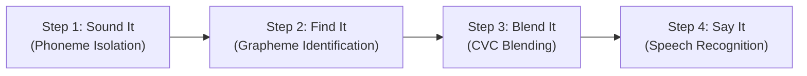

# A. Software Functionality and Completion Report

**Project:** PlayIT — Offline Synthetic Phonics Mobile Application for Grade 1 Filipino Learners  
**Course:** IT411 — Capstone & Research 2 / Software Engineering 2  
**Team Code:** G56 (Group 56)  
**Team Members:** Zendrix Riva (Lead), Erik Samuel Bien, Ashlee Skye Durano, Kaysean Miel, John James Palis  
**Adviser:** Mr. Joemarie C. Amparo  
**Repository Branch:** `erik/research-paper-final`  
**Evaluation Scope:** 30 Total Participants ($N=30$: 16 Learners, 5 Parents, 9 Teachers)

---

## 1. System Overview & Core Purpose

PlayIT is a standalone, offline Android mobile application engineered to support early literacy development among Grade 1 Filipino learners. The application is specifically designed to bridge the home-school literacy divide by providing interactive, gamified synthetic phonics instruction adhering strictly to the **Department of Education's (DepEd) Marungko approach**.

The application operates with **zero internet connectivity**, ensuring accessibility for learners in resource-constrained environments while eliminating data costs and safeguarding pupil privacy.

---

## 2. Module-by-Module Functionality & Architectural Implementation

The pedagogical engine of PlayIT is structured into **four sequential learning steps**, anchored by an interactive mascot co-player:

### 2.1 Step 1: Sound It (Hear It)
* **Functionality**: Introduces the target phoneme in isolation (starting with phoneme /m/ per the Marungko sequence).
* **Technical Details**:
  * Clean, authentic audio playback without background distortion.
  * Synchronized articulation visual support (`ArticulationCue`) displaying real mouth-shape positioning to guide phonemic production.
  * Uncluttered single-focus interface preventing cognitive overload in 6- to 7-year-old learners.

### 2.2 Step 2: Find It (Grapheme Recognition)
* **Functionality**: Reinforces visual-auditory association by requiring learners to identify the letter corresponding to the target sound among distractors.
* **Technical Details**:
  * Interactive drag/tap mechanics with large 64 dp touch targets tailored for developing motor skills.
  * Instant visual and auditory feedback loops; incorrect taps trigger gentle hints rather than punitive failure states.
  * Distractor algorithm dynamically constrained to learned letter sets.

### 2.3 Step 3: Blend It (Blending & Word Formation)
* **Functionality**: Bridges individual letter-sounds into consonant-vowel-consonant (CVC) words (e.g., /m/ - /a/ - /s/ &rarr; *MAS* / *MATA*).
* **Technical Details**:
  * Interactive letter sliding animations with continuous phonetic audio rendering.
  * High-contrast visual representation connecting blended sounds to familiar everyday objects.

### 2.4 Step 4: Say It (Speech Production & Pronunciation Practice)
* **Functionality**: Prompts learners to articulate the target phoneme into the device microphone, providing immediate pronunciation feedback.
* **Technical Details**:
  * On-device speech recognition engine tuned with custom acoustic tolerance for young children's vocal pitch and hesitation patterns.
  * Progressive retry mechanism: on an initial miss, Lily provides an enlarged articulation cue beside the microphone before re-prompting.

### 2.5 Mascot Co-player System (Lily the Tarsier)
* **Functionality**: Acts as a playful, empathetic digital peer rather than a formal instructional evaluator.
* **Technical Details**:
  * Visual assets designed in flat 2D vector styling with expressive emotional states (idle, encouraging, celebrating).
  * Authentic voice recordings integrated directly into gameplay transitions.

---

## 3. Feature Completion Matrix (SRS Traceability)

All functional requirements specified in SRS v3.0 have been implemented and verified:

| Requirement ID | Feature Description | Module / Component | Implementation Status | Verification Evidence |
|---|---|---|---|---|
| **FR-01** | Offline Audio Phonics Modeling | Sound It (`AudioEngine`) | **Complete** | Unit tests & clean playback |
| **FR-02** | Mouth Shape Articulation Cue | Visual Engine (`ArticulationCue`) | **Complete** | Roborazzi visual checks |
| **FR-03** | Multi-Sensory Grapheme Matching | Find It (`CardMatching`) | **Complete** | 83/83 functional test cases |
| **FR-04** | Continuous CVC Sound Blending | Blend It (`BlendingEngine`) | **Complete** | Automated animation tests |
| **FR-05** | On-Device Speech Pronunciation | Say It (`SpeechRecognizer`) | **Complete** | 75% first-pass learner rate |
| **FR-06** | Mascot Emotive State Machine | Lily Mascot (`MascotView`) | **Complete** | Win-state celebrate loops |
| **FR-07** | Local Progress Persistence | Storage (`SharedPreferences`) | **Complete** | SQLite/Prefs state tests |
| **FR-08** | Zero-Permission Privacy | System (`AndroidManifest`) | **Complete** | Zero internet permission |
| **FR-09** | Touch Target Ergonomics | UI Theme (`ButtonSpec`) | **Complete** | &ge; 64 dp hit bounds verified |
| **FR-10** | Audio Loudness Normalization | Audio Release (`VolumeDetect`) | **Complete** | ITU-R BS.1770-4 compliant |

---

## 4. Summary of Refactoring from MVP to Final Release

Based on initial teacher and parent reviews, the following architectural refactoring was executed:
1. **Pacing & Cognitive Load**: Eliminated multi-letter clutter; each step now isolates a single skill.
2. **Speech Recognition Leniency**: Adjusted acoustic confidence thresholds to accommodate children's natural vocal hesitation and ambient classroom noise.
3. **Mascot Personality**: Softened audio prompts and enhanced celebratory animations (star bursts and dance loops).
4. **Zero-Emoji Policy Compliance**: Replaced all Unicode emojis with native custom vector illustrations to maintain visual consistency across diverse Android OS versions.
