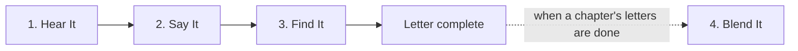

# A. Software Functionality and Completion Report

**Project:** PlayIT, an offline phonics app for Grade 1 learners  
**Course:** IT411 Capstone & Research 2 / Software Engineering 2  
**Team Code:** G56 (Group 56)  
**Team Members:** Zendrix Riva (Lead), Erik Samuel Bien, Ashlee Skye Durano, Kaysean Miel, John James Palis  
**Adviser:** Mr. Joemarie C. Amparo  
**Branch:** `erik/research-paper-final`  
**Evaluation scope:** 30 participants (16 Grade 1 learners, 5 parents or supervising adults, 9 teachers)

This report is written from the repository: `README.md`, the code under `app/`, and the Software Test Document (STD v1.0) in `docs/submission/` and `docs/std/`. Where the STD's result describes the midterm build (APK H) and not today's code, it says so.

---

## 1. What PlayIT Is

PlayIT is an Android app that teaches Grade 1 Filipino learners (ages 5 to 7) the sounds of the 26 English letters, in the order of the Marungko approach: hear the sound, say it, find it among pictures, then blend letters into words.

The speech recognizer (Vosk) runs on the phone, and the app has no internet permission. Nothing a child says or does leaves the device, and the app needs no connection or data.

---

## 2. How a Letter Is Taught

### 2.1 Hear It
Lily, the tarsier guide, models the sound: "Listen!", the sound three times, the key word, then the sound again. The child can replay it.

### 2.2 Say It
The child says the key word (for m, "mouse"). Vosk judges it on the phone against a grammar that holds the word and its likely mistakes (the letter's name, an added vowel). A miss gets a spoken correction for that mistake; the second miss shows the mouth shape beside the microphone; the third says it together with the child and moves on. Say It never takes a heart.

### 2.3 Find It
Five pictures; the child taps the three whose names start with the sound. A wrong tap costs one of five hearts. At zero hearts the child starts again with three.

### 2.4 Letter complete
Three stars with no hearts lost, two with one or two lost, one with three or more.

### 2.5 Blend It
When every letter of a chapter is done, that chapter's Blend It opens. The child builds its words (for Chapter 1: SAM, SIS, AM) from letter tiles, which are sounded out one by one and never dealt in the answer's order.

### 2.6 Lily, the mascot
Lily the tarsier guides every step with recorded voice lines and drawn poses (idle, waving, pointing, listening, encouraging, thinking, celebrating).

### 2.7 Parent Zone
Behind an arithmetic question: each letter's progress, a PDF report, and renaming or deleting profiles. The child never types; a new learner picks an animal avatar.

**Curriculum:** 26 letters in 7 chapters (m, s, a, i first). N with tilde and NG are not taught (SRS v3.0, section 1.2).

---

## 3. Architecture

Clean Architecture with MVVM, Hilt for dependency injection, and a Room (SQLite) database on the device (`PlayItDatabase`).

- `domain/`: pure Kotlin rules, for example `SpeechValidator`, `HeartManager`, `StarCalculator`, `TutorPolicy`, `UnlockManager`.
- `data/`: Room DAOs and repositories, audio playback, the Vosk recognizer, the PDF report.
- `presentation/`: Jetpack Compose screens and their ViewModels.
- `app/src/main/assets/`: the Vosk model, the sounds and the pictures.

Kotlin 1.9.23, Android Gradle Plugin 8.4.0, minimum Android 8.0 (API 26), target API 34.

---

## 4. Requirement Completion (SRS v3.0 rev. 3.8, as tested in STD v1.0)

The results below are the STD's, recorded on the midterm build APK H (commit `0320385`, October 2026). They are not all "complete": two test cases failed and several requirements were planned but not built or needed field measurement.

| Requirement | Feature | Result on APK H |
|---|---|---|
| FR-01 Carrier narration | Hear It | Pass |
| FR-02 Pure phoneme model and sequence | Hear It | Pass; device timing and teacher audit not run |
| FR-03 Tutoring loop, mic states, prompt ladder | Say It | Pass; device timing not run |
| FR-NEW-REC Spaced recall | Say It | Not built (planned) |
| FR-04 Find It grid | Find It | Pass, except TC-FND-03: **fail (DEF-01)** |
| FR-05 Hearts in Find It | Find It | Pass |
| FR-07 Heart recovery | Find It | Pass |
| FR-13 Decodable Blend It words | Blend It | Pass |
| FR-06 Star rules | Progression | Pass, except TC-PRG-02: **fail (DEF-02)** |
| FR-08 Linear unlock | Progression | Pass |
| FR-09 Daily streak | Progression | Pass |
| FR-14 Multi-profile | Profiles | Pass; TC-DB-03 partial |
| FR-10 Parent dashboard and gate | Parent Zone | Pass |
| FR-12 PDF report | Parent Zone | Pass |
| FR-NEW-TEL Telemetry and CSV export | Parent Zone | Not built (planned) |
| NFR-AUD-01 Audio release gate | Audio | Pass; teacher audit of the sounds pending |
| NFR-ASR-01 Judge accuracy and error types | Say It | Pass on the unit level; agreement with teachers not measured |
| NFR-PERF-01 Latency | All | Not measured |
| NFR-IND-01 Independent use, idle re-prompt | Lessons | Pass; field measure not run |
| NFR-ACC-01 Mouth-shape cues | Say It | Pass |
| NFR-ACC-02 64 dp targets, layout | All screens | Pass |
| NFR-SES-01 Session pacing | All | Not built (planned) |
| NFR-REL-01 Offline persistence | Data | Not run on the device |
| NFR-SEC-01 Local data only | Build | Pass |
| Team policies (zero emoji, no haptics) | All screens | Pass |

**Open defects (STD 7.2, also in the README's Known Limitations):**
- **DEF-01:** Find It draws its wrong pictures from every letter, not only from letters already learned.
- **DEF-02:** stars follow hearts lost only; the SRS's accuracy term is not applied.

**Today's code:** `./gradlew testDebugUnitTest` runs 697 tests: 691 passed, 6 skipped by design, 0 failed (re-run on 14 November 2026). 387 files under `app/` changed after APK H, so a build from this repository is not APK H. Before the paper says a requirement's status changed since the STD, check it against the code.

---

## 5. Changes Since the MVP (from the STD's incident log)

Seven problems were found in testing, fixed and re-tested (INC-01 to INC-07): silent Blend It words, wrong mouth shapes on some letters, a clipped title and overlapping attempt dots on small phones, a stale picture after "next letter", stars and hearts that did not follow results, controls smaller than 64 dp, and a Blend It deal that could already match the answer.

The team's zero-emoji policy (drawn pictures only, no Unicode emoji) is checked by `ZeroEmojiPolicyTest`.
