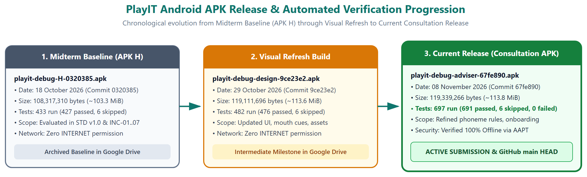

# B. Deployment and Source-Code Repository Guide

**Project:** PlayIT, an offline phonics app for Grade 1 learners  
**Course:** IT411 Capstone & Research 2  
**Team Code:** G56 (Group 56)  
**Team Members:** Zendrix Riva (Lead), Erik Samuel Bien, Ashlee Skye Durano, Kaysean Miel, John James Palis  
**Adviser:** Mr. Joemarie C. Amparo  

---

## 1. Source-Code Repository

The official source code repository is hosted publicly on GitHub:
- **Repository URL:** [https://github.com/zendrix-hub/playIt](https://github.com/zendrix-hub/playIt)
- **Primary Branch:** `main` (consolidates the full Android application under `app/`, automated tests, and TekCon 2026 research deliverables after merging completed feature and manuscript branches).

```bash
git clone https://github.com/zendrix-hub/playIt.git
cd playIt
```

---

## 2. Deployed Builds (Android packages)



PlayIT is installed directly from an APK file. It requires no remote server or cloud backend.

| File | Commit | Size | What it is |
|---|---|---|---|
| [`playit-debug-adviser-67fe890.apk`](https://drive.google.com/file/d/1pIr2360noHf64TOT-sAwk_uNlk2gSeQa/view?usp=sharing) | `67fe890` (8 Nov 2026) | 119,339,266 bytes (~113.8 MiB) | **Current Adviser-Feedback Release (Active Submission).** Built from `app/` on `main`: 697 automated tests (691 passed, 6 skipped by design, 0 failed). SHA-256: `A6D4560F0F593F0162D8B3A6A2A21EA173701966E54835CB27B64753579B184F`. [Download APK](https://drive.google.com/file/d/1pIr2360noHf64TOT-sAwk_uNlk2gSeQa/view?usp=sharing) |
| [`playit-debug-design-9ce23e2.apk`](https://drive.google.com/file/d/1alFzoNOlFLUVZCS6u-7Cxa0B3txgqzdJ/view?usp=sharing) | `9ce23e2` (29 Oct 2026) | 119,111,696 bytes (~113.6 MiB) | **Visual Refresh Milestone Build.** Intermediate release incorporating updated Compose visual polish and articulation cue refinements (`docs/design/visual-refresh.md`). [Download Design APK](https://drive.google.com/file/d/1alFzoNOlFLUVZCS6u-7Cxa0B3txgqzdJ/view?usp=sharing) |
| [`playit-debug-H-0320385.apk`](https://drive.google.com/file/d/1F-_kQS-M1TgwVd1CUBwMCXXqqFf_fmog/view?usp=sharing) | `0320385` (18 Oct 2026) | 108,317,310 bytes (~103.3 MiB) | **Midterm Baseline Build (APK H).** The baseline package evaluated in STD v1.0 (433 tests: 427 passed, 6 skipped, 0 failed). SHA-256: `b5a54c18d1405c3851b7fec5c110f03f1aeaaa899a343b12f1796e04398c42d4`. [Download Midterm APK](https://drive.google.com/file/d/1F-_kQS-M1TgwVd1CUBwMCXXqqFf_fmog/view?usp=sharing) \| [Midterm Portal Mirror](https://drive.google.com/file/d/1SeIXJS1z2YJwvh5mfNbVmIP9cExbRvkI/view?usp=sharing) |

All deployment builds, checksum dumps, and verification artifacts can be inspected directly on Google Drive:
- **Deployment Evidence Folder (All APKs & Hashes):** [02_Software_and_Deployment/04_Deployment_Evidence/](https://drive.google.com/drive/folders/1EsE5EoWxNN4gNl3EMTa_HPSo86touDZG)
- **Permissions & Security Audit PDF:** [DEPLOYMENT_AND_PERMISSIONS_INSPECTION.pdf](https://drive.google.com/file/d/1QW9g32vd7QYzZE6wSlKAvwgVVX-lzu2C/view?usp=sharing) (verifies zero `INTERNET` permission)
- **Midterm Submission Folder (Baseline Comparison):** [Midterm Portal Evidence Folder](https://drive.google.com/file/d/1SeIXJS1z2YJwvh5mfNbVmIP9cExbRvkI/view?usp=sharing)
- **Feature Completion Matrix:** [02_Software_and_Deployment/06_Feature_Completion_Matrix/](https://drive.google.com/drive/folders/1v_fHJXO2AwIbd_nplxpp8cl9JeRKoFOk)


**Test build, not for learners.** `playit-TEST-all-unlocked-67fe890.apk` (119,202,001 bytes) is the same code built with the `unlocked` build type: every letter and word game is open, so the team can reach any screen when looking for bugs. It installs as a separate app, "playIT test" (`com.playit.app.unlocked`), so its play never mixes with a child's record. It is not the build that is handed in. Build it with `./gradlew assembleUnlocked`.

---

## 3. Installing and Running

### 3.1 Device
- **Minimum:** Android 8.0 (API 26). **Target:** Android 14 (API 34).
- **Manual tests:** Samsung Galaxy A21s, the team's test phone (STD 5.5).
- **Automated layout checks:** four screen profiles: 360 x 640 dp (compact), 360 x 740 dp (A21s), 411 x 891 dp (phone), 800 x 1280 dp (tablet).

### 3.2 Installing the APK
1. Copy the APK to the phone and open it from the file manager.
2. If asked, allow "Install unknown apps" for the file manager.
3. Tap **Install**, then open **playIT** (the name shown under the app icon).

No account and no internet connection are needed. To make a profile:
- **Adviser-feedback build (the code in this repository):** on "Who is playing?", tap **New player**, pick an animal friend, type the child's name and tap **Let's Play**.
- **APK H and the design build:** on "Who is playing?", tap **Add Profile**, pick an animal friend and tap **Let's Play**.

### 3.3 Permissions (from `AndroidManifest.xml` and the APK inspection)
- **No `INTERNET` permission.** The app cannot send anything off the device.
- `RECORD_AUDIO`: for Say It. The speech recognizer runs on the phone.
- `READ_EXTERNAL_STORAGE` (Android 12L and lower only) and `WRITE_EXTERNAL_STORAGE` (Android 9 and lower only): declared for older Android versions.

---

## 4. Building From Source

### 4.1 Requirements
- JDK 17
- Android SDK with API 34 and Build Tools 34.0.0
- Gradle 8.9 comes with the wrapper; Android Gradle Plugin 8.4.0, Kotlin 1.9.23

Point Gradle at the SDK with `ANDROID_HOME`, or a `local.properties` file holding `sdk.dir=...` (use forward slashes on Windows).

### 4.2 Commands
```bash
./gradlew assembleDebug        # app/build/outputs/apk/debug/app-debug.apk
./gradlew testDebugUnitTest    # 697 tests: 691 passed, 6 skipped by design, 0 failed
```

Checked on 14 November 2026 on a second Windows PC (OpenJDK 17.0.16): `BUILD SUCCESSFUL`, 697 tests, 691 passed, 6 skipped, 0 failed. The six skipped tests are the font-scale 1.3 checks on the 360 x 640 profile. Results are written to `app/build/test-results/testDebugUnitTest/`.

A build from this repository is the adviser-feedback build (`67fe890`), not APK H: 387 files under `app/` changed after APK H.
