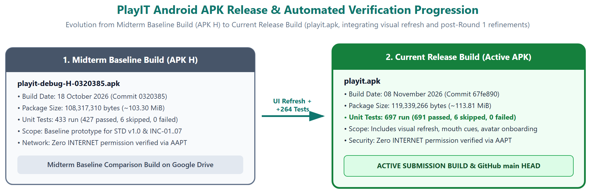

# PlayIT: APK Deployment and Permissions Inspection Report

**Course:** IT411 Capstone & Research 2  
**Date:** November 15, 2026  
**Team Code:** G56 (Group 56)  
**Team Members:** Zendrix Riva (Lead), Erik Samuel Bien, Ashlee Skye Durano, Kaysean Miel, John James Palis  
**Adviser:** Mr. Joemarie C. Amparo  
**Primary Branch:** `main` ([github.com/zendrix-hub/playIt](https://github.com/zendrix-hub/playIt))  
**Primary Current Build:** `playit.apk` (Commit `67fe890`)  
**Google Drive Folder:** [02_Software_and_Deployment/04_Deployment_Evidence/](https://drive.google.com/drive/folders/1EsE5EoWxNN4gNl3EMTa_HPSo86touDZG)  

---

## 1. File Verification & Build Matrix



The table below contrasts the current release build against the midterm baseline build. The active submission package for final evaluation and adviser consultation is **`playit.apk`** (Commit `67fe890`, built from `app/` on `main` at [github.com/zendrix-hub/playIt](https://github.com/zendrix-hub/playIt)), which integrates the full child-friendly visual refresh, animated mouth-shape cues, animal avatar onboarding, and post-Round 1 pedagogical refinements.

| Attribute | Current Release Build (`playit.apk`) | Midterm Baseline Build (`playit-debug-H-0320385.apk`) |
| :--- | :--- | :--- |
| **Commit Hash** | `67fe890` (Current release, incl. visual refresh) | `0320385` (Midterm baseline) |
| **Date** | 08 November 2026 | 18 October 2026 |
| **File Size (Bytes)** | **119,339,266 bytes** (~113.8 MiB) | 108,317,310 bytes (~103.3 MiB) |
| **SHA-256 Checksum** | `A6D4560F0F593F0162D8B3A6A2A21EA173701966E54835CB27B64753579B184F` | `b5a54c18d1405c3851b7fec5c110f03f1aeaaa899a343b12f1796e04398c42d4` |
| **Unit Test Suite** | **697 tests: 691 passed, 6 skipped, 0 failed** | 433 tests: 427 passed, 6 skipped, 0 failed |
| **Package ID** | `com.playit.app` | `com.playit.app` |
| **Version Code / Name** | `1` / `1.0.0` | `1` / `1.0.0` |
| **Min / Target SDK** | API 26 (Android 8.0) / API 34 (Android 14) | API 26 / API 34 |
| **INTERNET Permission** | **None** | **None** |
| **Google Drive Download** | [Download Current Release APK (`playit.apk`)](https://drive.google.com/file/d/1pIr2360noHf64TOT-sAwk_uNlk2gSeQa/view?usp=sharing) | [Download Midterm APK](https://drive.google.com/file/d/1F-_kQS-M1TgwVd1CUBwMCXXqqFf_fmog/view?usp=sharing) |

---

## 2. Core Architectural Boundaries & Permissions Inspection

PlayIT is engineered as an entirely self-contained educational tool for young Filipino learners, operating without dependencies on remote cloud infrastructure:

1. **Speech Recognition Architecture (Say It Module):**
   - Implemented using embedded Vosk (`vosk-android 0.3.47`) paired with a local phonetic model (`assets/vosk-model/`).
   - Acoustic inference executes on-device via local native libraries (`libvosk.so`, `libjnidispatch.so`).
   - Requires only `android.permission.RECORD_AUDIO`. Zero audio telemetry is transmitted off the phone.

2. **Haptic & Sensory Policy:**
   - No vibration or jarring haptics are requested: `android.permission.VIBRATE` is absent from the APK (Section 3).
   - The automated test `PerformancePolicyTest` (TC-POL-02) checks that the code makes no haptic-feedback calls.

3. **Storage & Privacy Isolation:**
   - Storage permissions (`READ_EXTERNAL_STORAGE`, `WRITE_EXTERNAL_STORAGE`) are strictly scoped with `maxSdkVersion='32'` and `maxSdkVersion='28'` respectively to comply with modern scoped storage on Android 10+.
   - Learner gameplay progress and animal avatar selection reside exclusively in sandboxed internal SQLite / Room database storage.

---

## 3. `aapt` Inspection Output (Current Release Build)

Run on 15 November 2026 with Android SDK Build Tools 34.0.0 against the copy of `playit.apk` downloaded from the Google Drive link above:

```text
$ aapt dump permissions playit.apk
package: com.playit.app
uses-permission: name='android.permission.RECORD_AUDIO'
uses-permission: name='android.permission.READ_EXTERNAL_STORAGE' maxSdkVersion='32'
uses-permission: name='android.permission.WRITE_EXTERNAL_STORAGE' maxSdkVersion='28'
permission: com.playit.app.DYNAMIC_RECEIVER_NOT_EXPORTED_PERMISSION
uses-permission: name='com.playit.app.DYNAMIC_RECEIVER_NOT_EXPORTED_PERMISSION'

$ aapt dump badging playit.apk   (package, SDK, label and icon lines)
package: name='com.playit.app' versionCode='1' versionName='1.0.0' platformBuildVersionName='14' platformBuildVersionCode='34' compileSdkVersion='34' compileSdkVersionCodename='14'
sdkVersion:'26'
targetSdkVersion:'34'
application-label:'playIT'
application-icon-120:'res/mipmap-anydpi-v26/ic_launcher.xml'
application-icon-160:'res/mipmap-anydpi-v26/ic_launcher.xml'
application-icon-240:'res/mipmap-anydpi-v26/ic_launcher.xml'
application-icon-320:'res/mipmap-anydpi-v26/ic_launcher.xml'
application-icon-480:'res/mipmap-anydpi-v26/ic_launcher.xml'
application-icon-640:'res/mipmap-anydpi-v26/ic_launcher.xml'
application-icon-65534:'res/mipmap-anydpi-v26/ic_launcher.xml'

$ sha256sum playit.apk
a6d4560f0f593f0162d8b3a6a2a21ea173701966e54835cb27b64753579b184f  playit.apk
```

The file is 119,339,266 bytes. No `android.permission.INTERNET` or `android.permission.VIBRATE` line appears in the output. The `DYNAMIC_RECEIVER_NOT_EXPORTED_PERMISSION` entry is added automatically by the AndroidX Core library: it is a signature-level permission private to the app and grants no network access.
