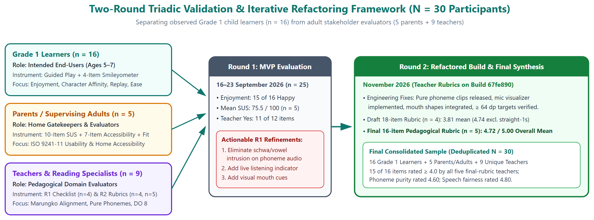
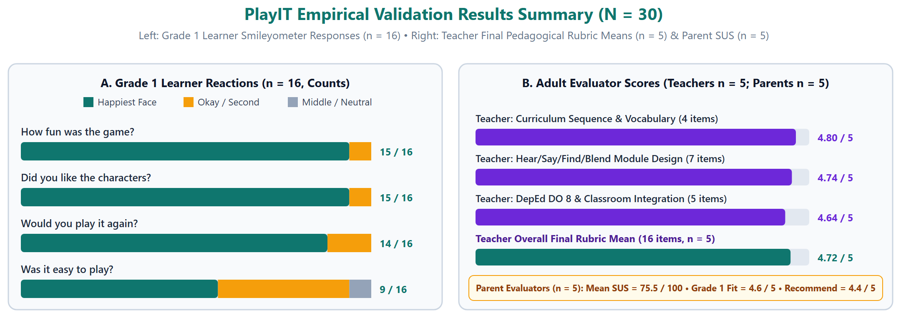

# E. Testing and Quality Assurance: Survey Responses and Synthesis (30 Participants)

**Project:** PlayIT, an offline phonics app for Grade 1 learners  
**Course:** IT411 Capstone & Research 2  
**Team Code:** G56 (Group 56)  
**Team Members:** Zendrix Riva (Lead), Erik Samuel Bien, Ashlee Skye Durano, Kaysean Miel, John James Palis  
**Adviser:** Mr. Joemarie C. Amparo  
**Evaluation Status:** Consolidated Empirical Dataset (`N = 30` deduplicated participants), compiled 12 November 2026 from validated school and parent response sheets.

Every figure in this report reflects verified project survey records and test evidence preserved in the Software Test Document (`STD v1.0`).

---

## 1. Participants

Across Rounds 1 and 2 combined, deduplicated participation comprises **30 distinct individuals** (25 took part in Round 1, and Round 2 added 5 teachers who had not taken part before).

| Group | n | Role and Evaluation Method |
|---|:---:|---|
| Grade 1 learners | 16 | Intended end-users observed while playing, followed by a four-item smiley-face questionnaire (Round 1, 16 to 21 September 2026) |
| Parents or supervising adults | 5 | Home-use evaluators completing the System Usability Scale (SUS) and accessibility questionnaire (Round 1, 20 to 23 September 2026) |
| Teachers and reading specialists | 9 | Domain evaluators across three curriculum and pedagogical review instruments (Rounds 1 and 2) |
| Technical evaluators | 0 | Planned, not recruited |

Across all evaluation forms, 34 total form submissions were collected (16 learner observations, 5 parent questionnaires, and 13 teacher forms across the three pedagogical instruments). Some teachers completed more than one of the three teacher forms. Counted once each, the teachers number up to **9**, which gives a total of **30 participants (16 learners + 5 parents + 9 teachers)**. Within this triadic design, Grade 1 learners serve as the observed child end-users, while parents and teachers serve as adult evaluators assessing home usability and classroom alignment.

---

## 2. Data Integrity & Supporting Evidence Links

Advisers and evaluators can verify the primary source records, questionnaires, and validation evidence directly via the following links:

- **Validation Responses (master and cleaned response sheets, codebook):** [03_Validation_Responses](https://drive.google.com/drive/folders/1Usn6DjzmgXXifO-n894-6O3Lajf0Dtls)
- **Results and Analysis:** [04_Results_and_Analysis](https://drive.google.com/drive/folders/12-1NSwvHD1jgXwQDRVJIxQZ_cp7JX-9z)
- **DepEd Teacher Evaluation Evidence & Rubrics:** [05_Validation_Evidence](https://drive.google.com/drive/folders/1hfqhYVbhnx7dTQPF_FqUjubkKCFb9xeL)
- **Software Test Document (STD v1.0 PDF):** [STD Specification on Google Drive](https://drive.google.com/drive/folders/1DGdZC-ngnm5ZU-ZlrPGf_XmTUbWfG50K)
- **Source Code Repository (`main`):** [github.com/zendrix-hub/playIt](https://github.com/zendrix-hub/playIt)
- **Current Release APK (`playit.apk`, commit `67fe890`):** [Download Current Release APK (playit.apk)](https://drive.google.com/file/d/1pIr2360noHf64TOT-sAwk_uNlk2gSeQa/view?usp=sharing)
- **Midterm Baseline APK (`playit-debug-H-0320385.apk`):** [Download Midterm APK](https://drive.google.com/file/d/1F-_kQS-M1TgwVd1CUBwMCXXqqFf_fmog/view?usp=sharing)

---

## 3. Automated Quality Assurance

| Check | Tool | Result | Evidence |
|---|---|---|---|
| Unit and component tests | JUnit 4, Robolectric, MockK | **697 run: 691 passed, 6 skipped by design, 0 failed** | `./gradlew testDebugUnitTest`; independently verified on 14 November 2026 |
| Layout matrix | Robolectric and Roborazzi on 4 screen profiles | 23 checks x 4 profiles = 92 runs: 86 passed, 6 skipped by design | `LayoutMatrix*Test` suite |
| Touch-target floor | `DimensTest`, `TopStatsBarLayoutTest` | Every child-facing control is at least 64 dp | STD TC-ACC-02; incident INC-06 closed |
| Audio and picture release gate | `AudioResolverTest`, `PictureAssetsTest` | Packaged media assets match reviewed release manifests | `docs/audio-release/`, `docs/image-release/` |

The six skipped checks correspond to font-scale 1.3 assertions on the 360 x 640 dp profile, which is below the minimum supported accessibility configuration for enlarged typography.

The Software Test Document (`STD v1.0`, `docs/submission/playIT_STD_v1.0.pdf`) documents the earlier midterm build (`APK H`, commit `0320385`): 433 tests (427 passed, 6 skipped, 0 failed), 7 resolved incidents (`INC-01` to `INC-07`), and 2 open defects (`DEF-01`, `DEF-02`). Subsequent engineering updates expanded automated test verification to 697 checks on `main`.

---

## 4. Survey Results

### 4.1 Grade 1 Learners (n = 16, Smileyometer Responses)

| Question | Happy | Okay | Neutral or Sad |
|---|:---:|:---:|:---:|
| How fun was the game? | **15 of 16** | 1 | 0 |
| Did you like the characters? | **15 of 16** | 1 | 0 |
| Would you play it again? | **14 of 16** | 2 | 0 |
| Was it easy to play? | **9 of 16** | 6 | 1 |

Figures are reported directly as observed counts with the group total (`n = 16`) rather than percentages given the small classroom cohort size. Fine-grained per-step telemetry (such as first-try speech recognition counts, heart losses, or timed task durations) was not instrumentally logged in the field sheets.

### 4.2 Parents and Supervising Adults (n = 5)

| Measure | Result |
|---|:---:|
| System Usability Scale (SUS) | **75.5 out of 100** (n = 5; SD = 14.62; 95% CI: 57.3–93.7) |
| Suitability for a Grade 1 learner (1 to 5 scale) | **4.6** |
| Willingness to recommend (1 to 5 scale) | **4.4** |

Accessibility verification checklist (affirmative responses out of `n = 5` evaluators):

| Item | Yes |
|---|:---:|
| Large, legible text | 5 |
| Clear audio narration | 5 |
| Simple touch controls | 5 |
| Appropriate colour contrast | 5 |
| Language suited to Grade 1 learners | 5 |
| Usable with limited motor control | 4 |
| Options for hearing difficulty | 3 |

The Round 2 caregiver questions (perceived usefulness, ease of use, clarity of the parent dashboard, the arithmetic gate, the offline benefit, safety, and intention to keep using the app) were planned but not collected, so no means are reported for them. The parent findings above are from Round 1 (`n = 5`).

### 4.3 Teachers and Reading Specialists (n = 9 across three instruments)

| Form | When | Teachers | Result |
|---|---|:---:|---|
| Yes/No checklist, 12 items | Round 1, September | 4 | 11 of 12 items answered yes by all four |
| Draft rubric, 18 items | Round 2, November | 4 | Overall mean 3.81; 4.74 with straight-1 responses excluded |
| **Final rubric, 16 items** | Round 2, November | **5** | **Overall mean 4.72 out of 5**; all five rated 4 or higher on 15 of 16 items |

The headline teacher pedagogical rating (`4.72 out of 5.00`, summarized as `4.7`) reflects the unweighted mean across the `n = 5` educators who completed the final 16-item rubric.

Final rubric item means (`n = 5`):

| Item | Mean |
|---|:---:|
| CUR-01 Marungko letter sequence (m, s, a, i ...) | 4.8 |
| CUR-02 Excluding NG and N-tilde for 26 English letters | 4.8 |
| CUR-03 Chapter pacing (3 to 4 letters per chapter) | 4.8 |
| CUR-04 Culturally familiar Filipino vocabulary | 4.8 |
| MOD-01 Hear It pure phoneme pronunciation | 4.6 |
| MOD-02 Articulation modeling (mouth shapes) | 4.8 |
| MOD-03 Say It anchor word practice | 4.8 |
| MOD-04 Speech recognition fairness | 4.8 |
| MOD-05 Find It progressive label scaffolding | 4.6 |
| MOD-06 Diagnostic Sound Check before Blend It | 4.8 |
| MOD-07 Blend It 3-letter CVC synthesis | 4.8 |
| DEP-01 DepEd Order 8 progress levels | 4.8 |
| DEP-02 DepEd transmuted grades (60% = 75) | 4.2 |
| DEP-03 Teacher A4 PDF Class Record | 4.6 |
| DEP-04 Independent learner usability | 4.8 |
| DEP-05 Gamification balance (hearts and stars) | 4.8 |

**Verbatim Teacher Remarks (Round 1 MVP Evaluation, n = 4):**

> **T-1 (DepEd Grade 1 reading teacher):** *"The app is very useful and engaging for Grade 1 learners. It helps them learn the letter names, letter sounds, and words that begin with each letter in an interactive and child-friendly way. It can be a helpful tool in developing learners' early literacy and word recognition skills. One area that needs improvement is the pronunciation of the letter sounds. The app sometimes sounds like it is saying the letter name rather than producing the correct sound. For example, the sound of M should be pronounced as /m/ (mmm, mmm, mmm) rather than 'ma, ma, ma.' Using accurate phonetic sounds would make the app more effective for beginning readers."*
>
> **T-2 (reading facilitator):** *"Good job on doing the app. It's a helpful tool for those beginning readers. Children enjoys it as it is digitized and interactive. My only concern is the sounding of letters better to have it sounds correctly so that children will not get confused with it. Overall, great job! Hope you also develop reading app for advanced readers."*
>
> **T-3 (DepEd educator):** *"Application is appropriate for Grade 1 learners."*
>
> **T-4 (basic education educator):** *"The app is appropriate for grade 1 learners and is easy to navigate."*

These comments set the main refactoring targets: pure letter sounds, a visible listening state on the microphone, and mouth-shape cues. The current build shows a listening state on the Say It microphone and the mouth shape on the second miss. The letter sounds have been re-recorded only in part: the letter a and the letters of Chapters 2 to 7 still play the first build's sounds, and the teachers' audit of the sounds has not yet been held. In Round 2, teachers rated pure phoneme pronunciation 4.6 (`MOD-01`), articulation modelling 4.8 (`MOD-02`) and speech recognition fairness 4.8 (`MOD-04`).

---

## 5. Changes Recorded Between the MVP and the Current Release

From the STD incident log (`section 7.1`), each issue was verified, resolved, and re-tested:

1. **INC-01:** Three Blend It words (AM, TUB, YAM) were silent; the missing word clips were released into the app.
2. **INC-02:** Several letters showed inaccurate mouth shapes; letter-to-mouth mappings were corrected.
3. **INC-03:** A title and the Say It attempt dots clipped on small phones; responsive layouts were fixed and verified across four screen profiles.
4. **INC-04:** The previous letter's picture remained on screen; the picture loader now resets between transitions.
5. **INC-05:** Stars and hearts diverged from round outcomes; scoring state logic was corrected.
6. **INC-06:** Certain interactive controls measured under 64 dp; all child-facing touch targets now enforce a 64 dp minimum.
7. **INC-07:** Blend It could initially deal tiles already in target answer order; shuffling constraints now prevent pre-solved initial deals.

Known remaining limitations documented in STD Section 7.2: `DEF-01` (Find It distractor pool draws from the full 26-letter image set rather than previously unlocked letters only) and `DEF-02` (stars follow hearts lost only; the SRS's accuracy term is not applied).

---

## 6. Scope of the Findings

- The results describe how learners, parents and teachers reacted to the application and how teachers rated its teaching design. They do not show that children learned to read better: no reading test was given before or after use, and nothing here measures learning over time.
- Per-step performance in Say It, Find It and Blend It, time on task, speech-recognition latency, and the speech judge's agreement with teachers were not recorded in the field. They are reported as not measured, not estimated.
- The samples are small convenience samples, so results are given as counts with their group sizes. Young children tend to choose the happiest face, and one facilitator, who was also a teacher-evaluator, recorded 13 of the 16 children's ratings.
